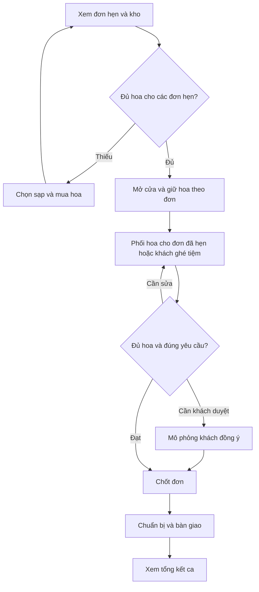

# Tiệm Hoa Mộc

> Mô phỏng một ngày mở tiệm hoa, từ cân vốn đi chợ đến phối bó theo ngân sách của khách và bàn giao đơn.

## 1. Ý tưởng

Người chơi vào vai chủ một tiệm hoa nhỏ. Đầu ngày, họ đọc sổ đặt trước, đối chiếu với kho và chọn mua hoa ở chợ. Khi mở cửa, hoa được giữ cho các đơn đã hẹn. Phần còn lại có thể dùng để phục vụ khách ghé tiệm. Mỗi đơn có yêu cầu về dịp tặng, màu sắc, hoa chính, lời chúc, giờ nhận và ngân sách.

Một đơn có thể có nhiều phương án hợp lệ. Người chơi có thể giữ loại hoa khách ưu tiên và đổi giấy gói để vừa ngân sách, hoặc đổi sang hoa khách đã chấp nhận. Quyết định mua buổi sáng ảnh hưởng trực tiếp đến lựa chọn trên bàn phối.

| Khoản tiền | Ý nghĩa |
|---|---|
| Tiền mặt của tiệm | Bắt đầu với **500.000 đ**. Giảm theo giá nhập khi xác nhận mua ở chợ. |
| Ngân sách của khách | Trần giá của từng đơn. Dùng để kiểm tra giá bán của bó hoa, gồm hoa, giấy và thiệp. |
| Doanh thu trong ngày | Tổng giá các đơn đã bàn giao. Màn hình tổng kết hiển thị riêng doanh thu và tiền nhập hoa. |

Vòng chơi buổi sáng, phục vụ khách và tổng kết cuối ngày lấy cảm hứng từ [bài hướng dẫn Tiệm Hoa Sớm Mai trên Sforum](https://cellphones.com.vn/sforum/cach-choi-game-tiem-hoa-som-mai). Tiệm Hoa Mộc gắn chuyến đi chợ với lượng hoa cần giữ cho các đơn đã hẹn và ngân sách riêng của từng khách.

## 2. Mockup tương tác

[Mở Tiệm Hoa Mộc](Tiem_Hoa_Moc_Mockup.html). Để mở từ máy tính, tải hai tệp về cùng một thư mục rồi mở tệp HTML bằng trình duyệt. Mockup dùng dữ liệu mẫu cho một ngày chơi. Tải lại trang sẽ bắt đầu lại từ đầu ngày.

| Màn hình | Bố cục và thông tin | Thao tác chính |
|---|---|---|
| **Chuẩn bị mở cửa** | Thanh tiền mặt ở trên. Sổ đơn hẹn và yêu cầu khách ở bên trái. Danh sách thiếu nguyên liệu ở bên phải. | Đi chợ hoa hoặc mở cửa khi kho đủ. |
| **Chợ hoa đầu ngày** | Danh sách cần mua, hai sạp hoa và giỏ hàng đặt cạnh nhau. Mỗi mặt hàng hiện giá, quy cách bán, số lượng còn và độ tươi. | Tăng hoặc giảm số lượng, xem dự báo thiếu hàng, xác nhận mua. |
| **Bàn phối hoa** | Cột trái có hàng đợi và phiếu yêu cầu. Cột giữa có hình bó hoa, giấy gói, thiệp và thanh ngân sách. Cột phải có danh sách hoa, tồn kho và nút tăng giảm số cành. | Tiếp khách mới, phối hoa, đổi hoa chính, chốt đơn, xác nhận chuẩn bị và bàn giao. |
| **Kho hoa** | Bảng theo loại hoa, giá bán một cành, lượng khả dụng và lượng đang giữ cho đơn. | Đối chiếu kho sau khi mua, mở cửa, chốt hoặc chuẩn bị đơn. |
| **Tổng kết ca** | Bảng trạng thái từng đơn, ngân sách, giá đã chốt, số đơn đã giao, chi nhập và doanh thu. | Kiểm tra kết quả xử lý đơn và số tiền phát sinh trong ca. |

## 3. Vòng chơi và luồng hoạt động

### 3.1. Chuẩn bị và đi chợ

1. Mở sổ đơn đặt trước, xem giờ lấy, số cành cần dùng và lời nhắn của khách.
2. Hệ thống cộng nhu cầu của hai đơn đặt trước và đối chiếu với kho để tính số cành cần mua.
3. Tại chợ, so sánh giá bán lẻ và giá theo bó. Thay đổi giỏ hàng để xem số tiền dự kiến còn lại và loại hoa còn thiếu.
4. Xác nhận mua. Hệ thống trừ tiền mặt, giảm hàng ở sạp, cộng số cành vào kho và làm trống giỏ.
5. Quay về **Mở tiệm**. Khi kho đủ, mở cửa sẽ giữ hoa riêng cho hai đơn hẹn và chuyển sang **Bàn phối hoa**.

| Tình huống | Phản hồi của hệ thống |
|---|---|
| Mở cửa khi còn thiếu hoa | Giữ tiệm ở trạng thái chưa mở và yêu cầu đi chợ. |
| Giỏ hàng vượt tiền mặt | Hiển thị khoản vượt. Tiền mặt, kho và số hàng ở sạp giữ nguyên sau lần xác nhận bị chặn. |
| Giỏ đạt số lượng còn ở sạp | Khóa nút tăng cho mặt hàng đó. |
| Kho đã đủ hoa | Có thể mở cửa ngay từ màn hình chuẩn bị. |

### 3.2. Phối hoa và xử lý khách

1. Chọn đơn, đọc yêu cầu về hoa chính, hoa cần tránh, lời chúc và ngân sách.
2. Tăng hoặc giảm số cành, chọn giấy gói và thiệp. Hình bó hoa, tổng giá và số tiền còn trong ngân sách cập nhật theo lựa chọn.
3. Nếu thiếu hoa chính, chọn loại thay thế. Đơn đã cho phép đổi có thể chốt sau khi kiểm tra giá và kho. Đơn cần khách duyệt sẽ chuyển sang **Chờ khách duyệt**, rồi người chơi mô phỏng khách đồng ý và chốt lại.
4. Khi chốt, hệ thống kiểm tra giá, số cành có thể dùng và yêu cầu của khách. Hoa dành riêng cho đơn hẹn được tính vào lượng có thể dùng của chính đơn đó. Nếu phương án cuối dùng ít hơn lượng đã giữ, phần dư trở về kho khả dụng.
5. Chọn **Đánh dấu đã chuẩn bị**, sau đó **Bàn giao cho khách**. Hoa đã chuẩn bị được tính là đã dùng, và giá đơn được cộng vào doanh thu khi bàn giao.

| Tình huống | Phản hồi của hệ thống |
|---|---|
| Giá bán bằng đúng ngân sách | Cho chốt nếu các điều kiện khác đạt. |
| Giá bán vượt ngân sách | Báo số tiền vượt và giữ đơn ở bước phối. |
| Đơn khách ghé tiệm cần nhiều cành hơn kho khả dụng | Báo số cành có thể dùng cho đơn. Hoa giữ cho các đơn hẹn vẫn dành riêng cho các đơn đó. |
| Có loại hoa khách yêu cầu tránh | Yêu cầu bỏ loại hoa đó trước khi chốt. |
| Đổi sang hoa cần duyệt | Đơn chờ xác nhận. Nếu sửa phương án sau khi duyệt, mockup kiểm tra lại khi chốt. |

Trạng thái chính của đơn là **Đang phối → Đã chốt → Đã chuẩn bị → Đã giao**. **Chờ khách duyệt** là một nhánh phát sinh trước khi chốt.

## 4. Dữ liệu mẫu và lượt chơi thử

| Đơn | Nguồn | Giờ nhận | Ngân sách | Yêu cầu |
|---|---|---:|---:|---|
| **TH-01 · Sinh nhật mẹ** | Đặt trước | 17:30 | 350.000 đ | Ưu tiên tulip hồng, chấp nhận hồng phấn. Thiệp ghi “Chúc mừng sinh nhật mẹ!”. |
| **TH-02 · Kỷ niệm ngày cưới** | Khách ghé tiệm | 18:00 | 320.000 đ | Ưu tiên tulip hồng. Cần khách duyệt nếu đổi sang cẩm chướng hồng. |
| **TH-03 · Cảm ơn cô giáo** | Đặt trước | 18:30 | 240.000 đ | Cúc vàng làm hoa chính và tránh baby trắng. |

**Tình huống mẫu.** Kho đầu ngày có 2 cành tulip. TH-01 dự kiến dùng 5 cành nên cần mua thêm 3 cành.

| Cách nhập tulip | Tiền nhập | Tiền mặt còn | Tulip khả dụng sau khi giữ 5 cành cho TH-01 |
|---|---:|---:|---:|
| Mua lẻ 3 cành ở Sạp Cô Lan | 105.000 đ | 395.000 đ | 0 cành |
| Mua 1 bó 5 cành ở Sạp Nhà Vườn | 140.000 đ | 360.000 đ | 2 cành |

Để thử toàn bộ luồng, chọn phương án mua theo bó. Về **Mở tiệm**, mở cửa rồi chọn TH-01. Phương án mặc định có giá **370.000 đ**. Đổi sang **Giấy kem** để tổng còn đúng **350.000 đ**, rồi chốt. Sau đó nhấn **Tiếp khách ghé tiệm**. TH-02 cần 4 cành tulip nhưng chỉ còn 2 cành khả dụng. Chọn **Đổi hoa chính**, mô phỏng khách đồng ý đổi sang cẩm chướng, chốt đơn, đánh dấu đã chuẩn bị và bàn giao. Mở **Tổng kết** để xem kết quả.

## 5. Phạm vi và ý tưởng mở rộng

Bản hiện tại có một ngày chơi, một vai trò chủ tiệm, hai sạp, sáu loại hoa, ba loại giấy gói, hai kiểu thiệp và ba đơn mẫu. Độ tươi xuất hiện trên bảng giá ở chợ. Các giờ nhận được hiển thị trên phiếu đơn.

| Ý tưởng mở rộng | Cách đưa vào trò chơi |
|---|---|
| **Mở tiệm lần đầu** | Cho đặt tên cửa hàng và giới thiệu quầy, sổ đơn, kho và vốn khởi điểm. |
| **Dự báo nhu cầu** | Thông báo các dịp như lễ tốt nghiệp ở trường gần tiệm. Người chơi cân nhắc mua thêm theo dự báo. |
| **Độ tươi theo lô** | Qua ngày, độ tươi giảm theo lô. Ưu tiên dùng hoa sớm hết hạn và tính số cành phải bỏ. |
| **So sánh hai phương án phối** | Đặt hai bản phối cạnh nhau để xem giá, màu, số cành và điều kiện khách duyệt. |
| **Hủy đơn hoặc sửa lời chúc** | Hủy trước khi bó thì giải phóng phần đã giữ. Hủy sau khi bó thì ghi nhận phần dùng lại được. Khi sửa thiệp, cập nhật phiếu chuẩn bị. |
| **Giờ chơi và cấp độ** | Bắt đầu với một đơn, sau đó mở khóa tình huống hết hàng, nhiều đơn cùng dùng một loại hoa và giao sát giờ. Chấm theo yêu cầu, thời gian và hao hụt. |

## 6. Tình huống thực hành kiểm thử

| Mã | Kiểm tra | Kết quả mong đợi |
|---|---|---|
| QA-01 | Mở tiệm khi chưa mua thêm 3 cành tulip | Tiệm chưa mở và thông báo kho còn thiếu hoa cho đơn hẹn. |
| QA-02 | Cho 4 bó tulip giá 140.000 đ vào giỏ với vốn 500.000 đ rồi xác nhận | Báo vượt vốn 60.000 đ. Kho vẫn có 2 cành tulip và vốn vẫn là 500.000 đ. |
| QA-03 | Mua một bó 5 cành rồi mở cửa | Tiền mặt còn 360.000 đ. Kho có 2 cành tulip khả dụng và 5 cành đang giữ cho TH-01. |
| QA-04 | Chốt TH-01 ở mức 370.000 đ, sau đó đổi giấy để chốt đúng 350.000 đ | Lần đầu báo vượt 20.000 đ. Lần sau đơn chuyển sang **Đã chốt**. |
| QA-05 | Tiếp TH-02 sau khi giữ hoa cho TH-01 và đề xuất đổi cẩm chướng | Báo chỉ còn 2 cành tulip khả dụng. Phương án đổi hoa đi qua bước **Chờ khách duyệt**. |
| QA-06 | Thêm một cành baby trắng vào TH-03 rồi chốt | Hệ thống yêu cầu bỏ baby trắng và đơn chưa được chốt. |
| QA-07 | Bàn giao TH-02 sau khi đổi sang cẩm chướng với mẫu phối mặc định | Tổng kết ghi **Đã giao** và doanh thu đơn là 192.000 đ. |
